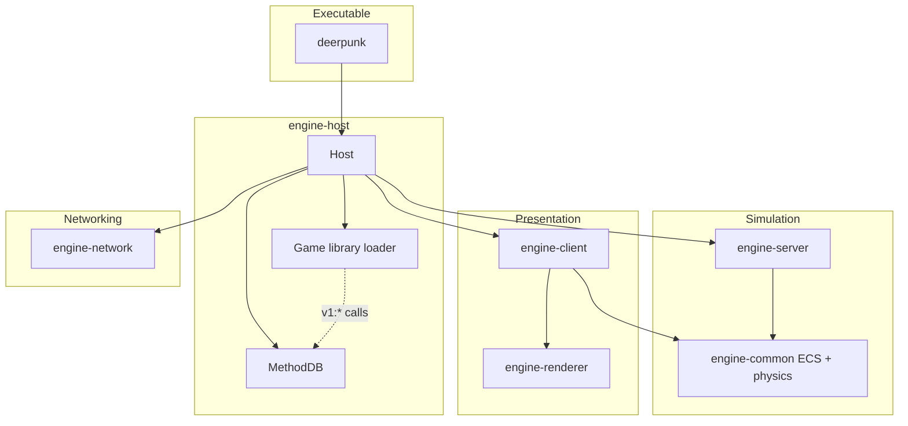
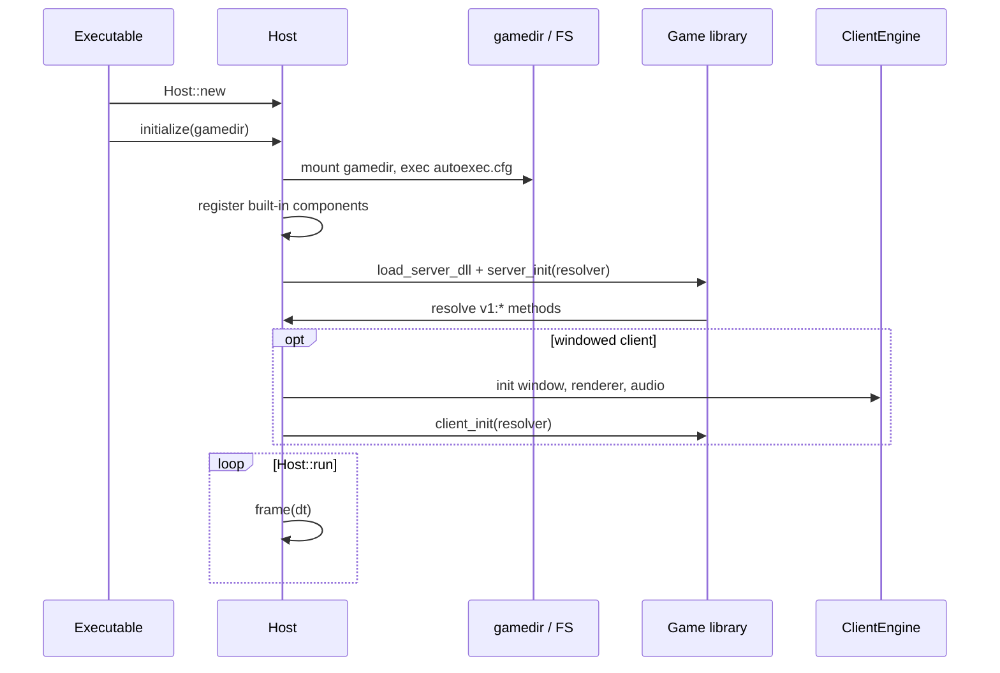
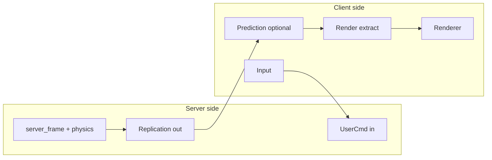
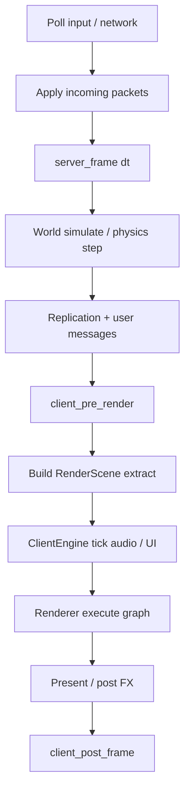

# Architecture

deerpunk splits **simulation** (server), **presentation** (client), and **GPU** (renderer) into separate crates. A single **host** process loads your game library and drives the frame loop.

## Crate map

| Crate | Responsibility |
|-------|----------------|
| `engine-host` | Owns subsystems, loads game DLL, exposes MethodDB |
| `engine-server` | Server tick, networking glue, no window |
| `engine-client` | Window, input, scene extract, audio backend hook |
| `engine-renderer` | wgpu: snapshots → HDR frame → tonemap |
| `engine-common` | ECS world, components, physics, materials types |
| `engine-network` | Packets, user cmds, replication messages |
| `engine-resource` | Files, meshes, shaders, WAD loaders |
| `engine-api` | Safe Rust API for game libraries |

### Dependency rules

- **Game libraries** link only `engine-api` / SDK — never `engine-host` or `engine-common` directly.
- **Renderer** consumes `RenderSnapshot` only; it does not query ECS.
- **Client** reads the world through extractors; it does not run authoritative gameplay.

Three contracts:

1. **MethodDB ABI** — string methods + opaque `ctx` ([api.md](api.md)).
2. **Internal Rust API** — `World`, schedules, physics inside the host.
3. **Render contract** — `RenderScene` / mesh draws / cameras ([assets.md](assets.md)).

---

## Startup sequence

Steps in plain language:

1. **Create host** — allocate `ServerEngine`, optional `ClientEngine`, command/cvar systems, resource manager.
2. **Initialize gamedir** — all content paths are relative to the game directory.
3. **Load game library** — dynamic library with `server_init` / `client_init`.
4. **Resolve API** — game code caches MethodDB function pointers.
5. **Run loop** — simulation, replication, extract, render (see below).

---

## Server vs client

| | Server | Client |
|---|--------|--------|
| **World** | Authoritative ECS + physics | Replica + `client_world` for local FX |
| **Code entry** | `server_frame` | `client_frame`, `client_pre_render`, … |
| **Input** | Reads `UserCmd` per player slot | Samples keyboard/mouse → sends `UserCmd` |
| **Rendering** | May call renderer for dedicated tools | Full window, cameras, UI |
| **Truth** | Decides gameplay outcomes | Predicts locally, accepts corrections |

In a **listen server**, host runs server and client in one process: server simulates, client draws and sends cmds to localhost.

The client **must not** treat local-only actions as authoritative for other players. Use server decisions delivered via replication or user messages.

---

## Frame loop

- **Extract** runs on the client: entities with `TransformComponent`, `Mesh3D`, `DrawMaterial`, cameras, lights → flat draw lists.
- **HDR pipeline**: lighting accumulates in linear space; tonemapping is a dedicated pass (exposure controlled via renderer cvars on the host).

---

## Game library (gamelib)

Your game ships as a **`cdylib`**:

- **Server exports** — init, frame, shutdown for rules, spawning, damage, etc.
- **Client exports** — rendering hooks, prediction, UI, local effects.

The engine does not embed game rules. It only provides systems through MethodDB.

Component types used in replication must match on server and client (same size, alignment, field order). Register components before spawn.

---

## MethodDB (summary)

All cross-boundary calls use **`v1:namespace:method`** resolved at init. Implementations live in `engine-host` (see [api.md](api.md) for the full list).

Do not expose `Host` struct pointers to game code — only `ctx: *mut u8` passed into each callback.

---

## Related documents

- [api.md](api.md) — MethodDB namespaces and methods  
- [network.md](network.md) — packets, replication, user messages  
- [assets.md](assets.md) — materials, meshes, gamedir layout  
