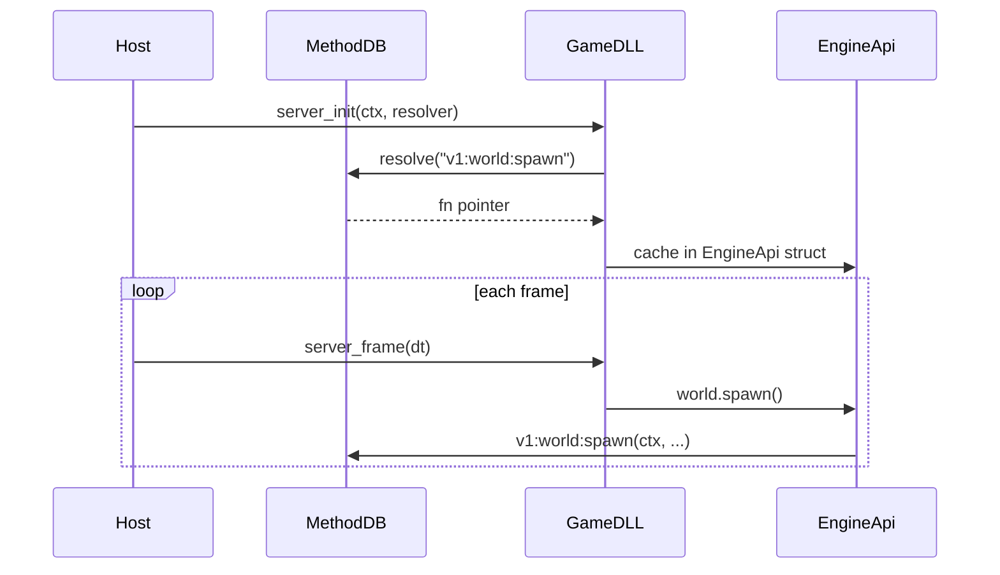

# MethodDB API reference

Game libraries call the engine through **MethodDB**: each function is registered under a stable string `namespace:method` (for example `v1:world:spawn`). At init the host passes a **resolver**; the game library looks up names once and caches function pointers.

## How names are formed

```text
v1:<namespace>:<method>
```

| Part | Meaning |
|------|---------|
| `v1` | API generation (bump only on breaking ABI changes) |
| `namespace` | Subsystem (`world`, `net`, `audio`, …) |
| `method` | Operation within that namespace |

Bindings are declared in the host with `#[methoddb::namespace]` and `#[methoddb::bind]`. The **scope** attribute lists which DLLs may resolve the method: `"server"`, `"client"`, or both.

## Where implementations live

| Location | Role |
|----------|------|
| `crates/engine-host/engine_methoddb.rs` | Most namespaces (net, world, audio, mesh, …) |
| `crates/engine-host/engine_api/*.rs` | Renderer, materials, client world (colocated with subsystem) |
| `crates/engine-host/cmd.rs` | `v1:cmd` |
| `crates/engine-host/cvar.rs` | `v1:cvar` |
| `crates/engine-api` | Safe Rust facades that resolve the same names |

The host builds a **MethodDB** table at startup; the game library never links against `engine-host`.

## Bootstrap (game library exports)

The host loads the server game library and client game library (when present) and calls their init exports with:

- `version` — must match the engine API version
- `ctx` — opaque `*mut u8` pointing at the host (only passed into MethodDB callbacks)
- `resolver(name, len)` — returns a function pointer or null

Typical exports:

| Export | Called when |
|--------|-------------|
| `server_init` | Server (or listen-server) game logic starts |
| `server_frame(dt)` | Fixed or variable simulation step |
| `server_shutdown` | Tear down |
| `client_init` | Client-side game code starts |
| `client_frame(dt)` | Per-frame client logic (input, prediction, UI hooks) |
| `client_pre_render(dt)` | After network apply, before scene extract |
| `client_post_frame(dt)` | After render |
| `client_shutdown` | Tear down |

Use `deerpunk_engine_api::EngineApi` (or `deerpunk_engine_sdk`) to wrap the resolver; do not call raw function pointers from scattered code.

---

## `v1:engine`

**Source:** `crates/engine-host/engine_methoddb.rs`  
**Scope:** server, client

| Method | Purpose |
|--------|---------|
| `frame` | Host frame hook (internal scheduling) |
| `shutdown` | Request engine shutdown |

---

## `v1:world`

**Source:** `crates/engine-host/engine_methoddb.rs`  
**Scope:** server and client (server-only methods on server DLL)

| Method | Purpose |
|--------|---------|
| `spawn` | Create empty entity |
| `destroy` | Destroy entity (server scope) |
| `has` / `get` / `set` / `remove` | Component access on authoritative world |
| `clear` | Clear world (stub / limited) |
| `free_value` | Companion for `get` lifetime |
| `spawn_prefab` | Instantiate prefab by name |
| `spawn_bundle` | Spawn from bundled description |
| `component_register` | Register component type (server) |
| `query` / `query_count` / `query_matches` | Entity queries |
| `query_prepare` / `query_execute` | Prepared queries |

Authoritative simulation and physics run on the **server world**. Clients receive replicated state; see [network.md](network.md).

---

## `v1:client_world`

**Source:** `crates/engine-host/engine_methoddb.rs`  
**Scope:** server, client

Client-side ECS for presentation: extra meshes, particles, local-only entities. Same shape as world (`spawn`, `get`, `set`, `query`, …) but does not affect server authority.

**Safe wrapper:** `crates/engine-api/src/client_world.rs`

---

## `v1:mesh`

**Source:** `crates/engine-host/engine_methoddb.rs`  
**Scope:** client, server

| Method | Purpose |
|--------|---------|
| `create` / `create_with` | Upload mesh geometry; returns handle |
| `register_allocator` / `allocator_id` | Custom mesh heap tags |
| `content_id` | Stable content id for GPU deduplication |

Mesh lifetime is owned by the host **MeshRegistry**; there is no `release` — drop handles on the engine side when entities despawn.

---

## `v1:bone_buffer`

**Source:** `crates/engine-host/engine_methoddb.rs`  
**Scope:** client

| Method | Purpose |
|--------|---------|
| `alloc` / `free` / `write` | GPU bone palette uploads for skinned meshes |

---

## `v1:net`

**Source:** `crates/engine-host/engine_methoddb.rs`  
**Scope:** server, client

| Method | Purpose |
|--------|---------|
| `client_cmd` | Run client console command string |
| `in_game` | Whether client finished join (`InitDone`) |
| `msg_register` / `msg_send` / `msg_hook` | **User messages** — named binary channels (see network doc) |
| `send_usercmd` | Client → server movement/input cmd |
| `player_net_id` | Local player network id |

User messages are the usual way to send game-specific payloads (inventory, chunks, HUD) without extending the core `SVC` enum.

---

## `v1:players`

**Source:** `crates/engine-host/engine_methoddb.rs`  
**Scope:** server, client

| Method | Purpose |
|--------|---------|
| `set_entity` / `local_entity` | Map slot ↔ entity |
| `get_usercmd` | Server reads buffered user cmd for slot |
| `set_simorg` / `clear_simorg` | Prediction / correction helpers |
| `usercmd_ack` / `usercmd_outgoing` / `usercmd_sent_time` | Cmd sequencing |
| `server_feet` | Authoritative feet position for slot |
| `prediction_correction` | Client-side correction hint |
| `usercmd_lookup` | Historical cmd lookup |

---

## `v1:move`

**Source:** `crates/engine-host/engine_methoddb.rs`  
**Scope:** client only

| Method | Purpose |
|--------|---------|
| `snapshot` | Movement prediction snapshot for local player |

---

## `v1:client`

**Source:** `crates/engine-host/engine_methoddb.rs`  
**Scope:** client

| Method | Purpose |
|--------|---------|
| `set_view_net_id` | Which entity drives the main camera |
| `set_lightstyle` | Animated light style index |
| `scene_time` | Renderer scene time (seconds) |
| `view_ray` | Eye position + forward for traces / audio |
| `debug_aabb` | Debug draw AABB |

---

## `v1:server`

**Source:** `crates/engine-host/engine_methoddb.rs`  
**Scope:** server

| Method | Purpose |
|--------|---------|
| `set_enabled` / `is_enabled` / `activated` | Server module toggles |

---

## `v1:audio`

**Source:** `crates/engine-host/engine_methoddb.rs`  
**Scope:** server and client (`set_world_mesh` client-only block)

| Method | Purpose |
|--------|---------|
| `play_2d` | One-shot or looping 2D event; returns `sound_id` |
| `play_3d` | One-shot 3D at world origin |
| `start_attached` | Looping sound following entity |
| `stop_sound` | Stop by `sound_id` |
| `set_world_mesh` | Optional spatial audio scene mesh (client) |

Server-authoritative sounds are queued as `SVC::SoundPlay` packets; see [network.md](network.md). Event definitions load from the game datapack (`sound_banks`, `sound_events`).

**Safe wrapper:** `crates/engine-api/src/audio.rs`

---

## `v1:renderer`

**Source:** `crates/engine-host/engine_methoddb.rs`, `crates/engine-host/engine_api/renderer.rs`  
**Scope:** server, client

| Method | Purpose |
|--------|---------|
| `load_texture` | Legacy texture slot upload |
| `upload_texture_raw` | Raw RGBA upload |
| `upload_lightmap_uri` / `upload_lightmap_raw` | Lightmap atlas |
| `set_scene_lighting` | Sun, ambient, point lights uniform |
| `set_sky_palette` / `set_procedural_sky` / `set_gamelib_sky` | Sky pass data |
| `load_shader` / `reload_shaders` | Shader hot reload |

Rendering uses **linear HDR** internally; tonemapping runs in the post pass. Albedo uploads should be **linear** unless the material marks sRGB sampling.

---

## `v1:materials`

**Source:** `crates/engine-host/engine_api/materials.rs`  
**Scope:** server, client

| Method | Purpose |
|--------|---------|
| `load` | Load `.mat.json` from gamedir |
| `create` | Create material from descriptor |
| `reload` | Reload shader / params |
| `set_texture` | Bind atlas slot on material |

---

## `v1:physics`

**Source:** `crates/engine-host/engine_methoddb.rs`  
**Scope:** server, client

| Method | Purpose |
|--------|---------|
| `trace_line` | Static mesh / BSP line trace |
| `create_shape` / `destroy_shape` | Collider shapes |
| `create_parts` / `destroy_parts` | Compound bodies |
| `cast_capsule` | Swept capsule (dynamic) |

---

## `v1:input`

**Source:** `crates/engine-host/engine_methoddb.rs`  
**Scope:** server, client (meaningful on client)

| Method | Purpose |
|--------|---------|
| `is_key_down` | Key state |
| `mouse_dx` / `mouse_dy` | Relative mouse delta |
| `take_mouse_wheel` | Wheel delta since last frame |
| `set_relative_mouse` | Capture mode |

---

## `v1:ui`

**Source:** `crates/engine-host/engine_methoddb.rs`  
**Scope:** server, client

| Method | Purpose |
|--------|---------|
| `load` / `unload` | RmlUi document |
| `show` / `hide` | Visibility |
| `lua_eval` | Run Lua in document context |
| `data_model_set_bool` / `_number` / `_string` | Bind UI model fields |

---

## `v1:cmd` / `v1:cvar`

**Source:** `crates/engine-host/cmd.rs`, `crates/engine-host/cvar.rs`  
**Scope:** server, client

| Namespace | Methods |
|-----------|---------|
| `v1:cmd` | `register`, `execute` |
| `v1:cvar` | `set`, `get_f32` |

Console and config files (`autoexec.cfg`, `config.cfg`) run through the command system at init.

---

## `v1:log`

**Source:** `crates/engine-host/engine_methoddb.rs`  
**Scope:** server, client

| Method | Purpose |
|--------|---------|
| `write` | Log line from game library |

---

## `v1:resources`

**Source:** `crates/engine-host/engine_methoddb.rs`  
**Scope:** server, client

| Method | Purpose |
|--------|---------|
| `register` | Register resource loader type |

**ResourceManager** details: [assets.md](assets.md).

---

## `v1:schedule`

**Source:** `crates/engine-host/engine_methoddb.rs`  
**Scope:** server, client

| Method | Purpose |
|--------|---------|
| `add_system` / `clear` / `run` | ECS schedule systems (legacy path) |

---

## `v1:host`

**Source:** `crates/engine-host/engine_methoddb.rs`  
**Scope:** mixed (see each method)

| Method | Typical scope | Purpose |
|--------|---------------|---------|
| `register_main_console` | server | Hook game console |
| `start_listen_map` | server | Begin listen server on map |
| `flush_pending_albedos` | client | Apply deferred texture uploads |
| `refresh_stream_meshes` | client | Streaming mesh refresh |
| `client_track_static` | client | Static mesh tracking |
| `client_apply_mesh_uri` | client | Apply mesh from URI |

---

## Resolver flow (diagram)



---

## POD rules for components

Components exchanged through `world:get` / `world:set` must be `#[repr(C)]` plain data: no `String`, `Vec`, or Rust references in the layout. Register types with `component_register` or the SDK `#[game_component]` macro. Violations break FFI and replication.
