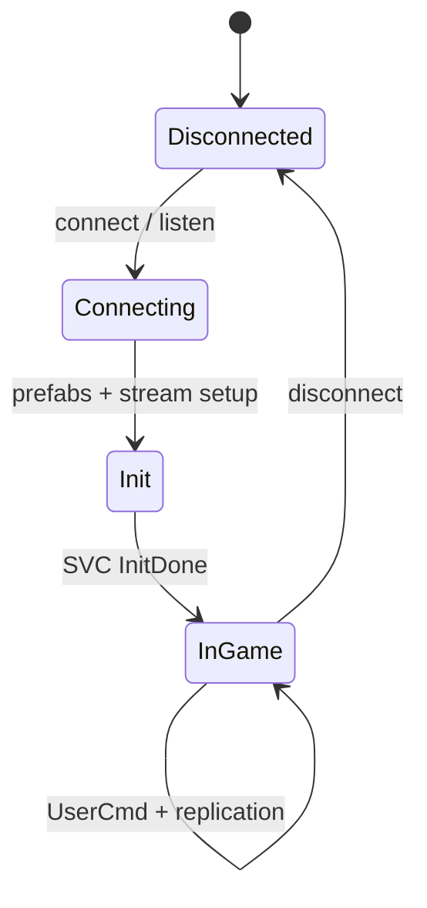
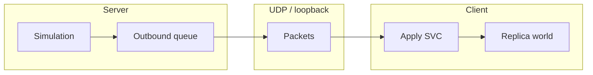
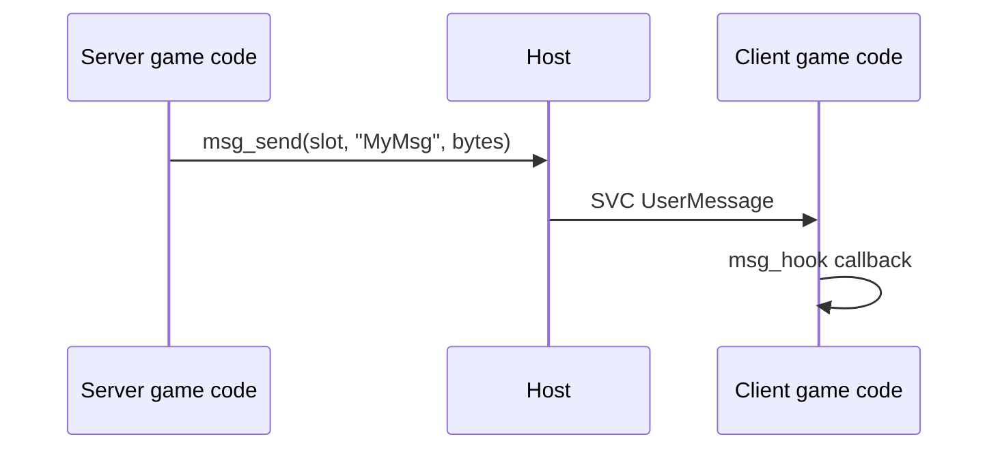
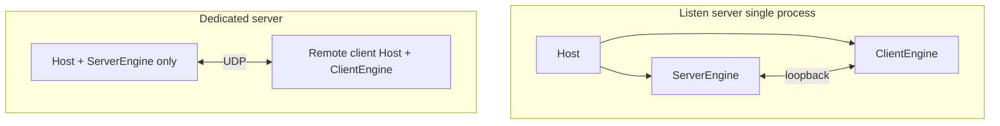

# Networking

Client and server exchange binary **packets** over UDP (or loopback in a listen server). The first byte selects the message kind: **SVC** (server → client) or **CLC** (client → server).

## Connection phases

During **Init**, the server sends prefab definitions and spawns baseline entities. **`SVC::InitDone`** tells the client that `in_game` is true and user commands will be processed.

---

## Server → client (`SVC`)

Defined in `crates/engine-network/src/protocol.rs`.

| Value | Name | Role |
|------:|------|------|
| 0 | `Nop` | Padding |
| 2 | `SoundPlay` | Start one-shot or looping sound (see below) |
| 3 | `SpawnPrefab` | Spawn replicated or static entity |
| 4 | `NetDelta` | Hot fields on a `NetworkEntity` |
| 5 | `NetDestroy` | Remove replicated entity |
| 6 | `UserMessage` | Game-specific payload (see user messages) |
| 7 | `PrefabDef` | JSON prefab schema during join |
| 8 | `InitDone` | End join; client may play |
| 9 | `SoundStop` | Stop sound by server `sound_id` |
| 10 | `StreamIn` | Entity enters interest set |
| 11 | `StreamOut` | Entity leaves interest set |
| 12 | `StreamUpdate` | Batched field updates |
| 13 | `UserCmdAck` | Last processed client cmd sequence |

---

## Client → server (`CLC`)

Primary payload: **`UserCmd`** — movement buttons, view angles, weapon buttons, sequence number. The server reads cmds per **player slot** via `v1:players:get_usercmd`.

Input on the client does not go straight into server physics; it is always cmd-shaped for prediction and anti-cheat headroom.

---

## User messages

Game-specific binary messages use **`SVC::UserMessage`**: a registered `msg_id` plus payload.

MethodDB wrappers (`v1:net`):

| Method | Side | Purpose |
|--------|------|---------|
| `msg_register` | Both | Name → id, max size |
| `msg_send` / `msg_broadcast` | Server | Send to one or all clients |
| `msg_hook` | Client | Callback when message arrives |

Typical uses: chunk data, inventory, HUD, custom events. Keep payloads fixed-size or length-prefixed; the engine does not parse game semantics.

---

## Sound over the network

Gameplay sounds should be **server-driven**:

1. Server calls `v1:audio:play_3d` (or `play_2d` / `start_attached`).
2. Host assigns a **`sound_id`** and enqueues **`SVC::SoundPlay`** to clients.
3. Client audio backend plays the named **sound event** from the datapack.
4. **`SVC::SoundStop`** ends looping instances.

This keeps one-shot and looping sounds consistent for all listeners. Client-only feedback (UI clicks) may call audio directly without network.

Sound RPC layout: `crates/engine-network/src/sound_event.rs`.

---

## Replication model

Entities that must appear on clients carry **`NetworkEntity`**. The server spawns with **`SpawnPrefab`**; field changes use **`NetDelta`** or stream batch updates.

| Concept | Meaning |
|---------|---------|
| `net_id` | Stable id on the wire |
| Static spawn | `net_id == 0` scene entities (e.g. world root) |
| Stream in/out | Interest management for large worlds |

Prefab JSON is sent once per connect (`PrefabDef`) so clients know component layouts before deltas arrive.

---

## Listen server vs dedicated

Default game port is configurable; LAN discovery optional via engine server modules.

---

## MethodDB cross-reference

| Task | API |
|------|-----|
| Register message | `v1:net:msg_register` |
| Send to client | `v1:net:msg_send` |
| Hook on client | `v1:net:msg_hook` |
| Send input | `v1:net:send_usercmd` |
| In game? | `v1:net:in_game` |
| Play replicated sound | `v1:audio:play_3d` (server) |

Full list: [api.md](api.md).
