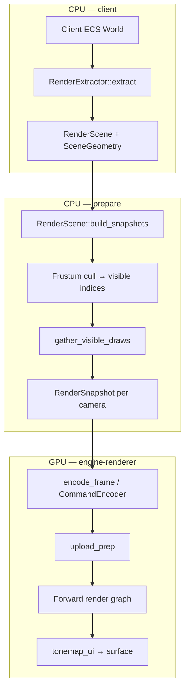
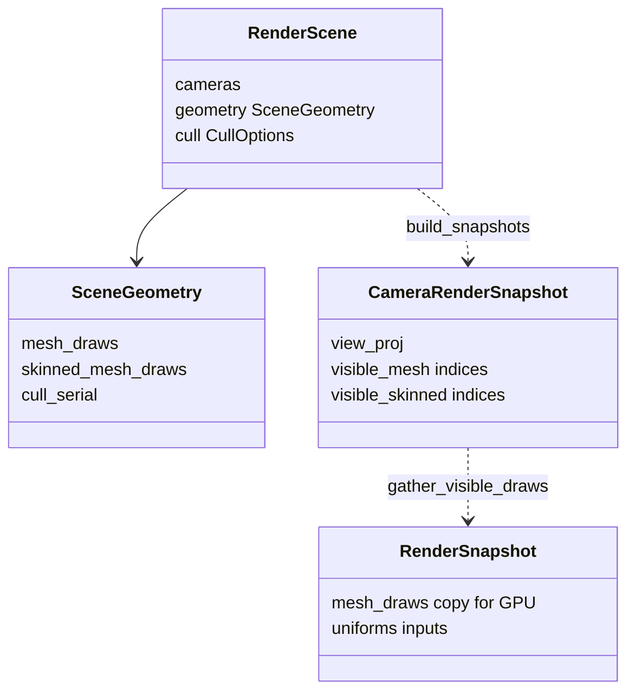
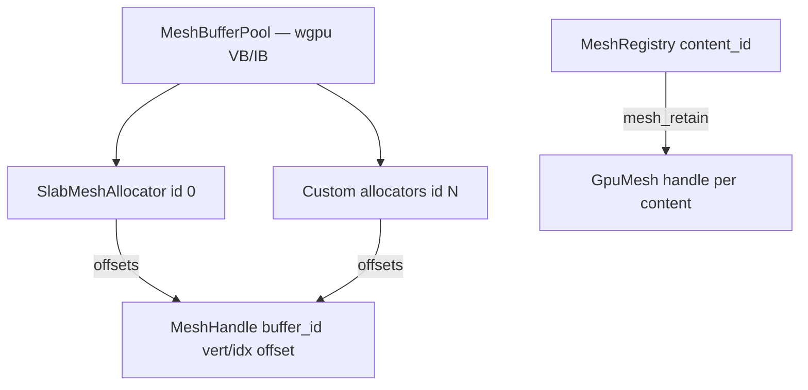

# Renderer

The GPU stack lives in **`crates/engine-renderer`**. The client (`crates/engine-client`) walks ECS entities and builds a **`RenderScene`**; the renderer turns per-camera **`RenderSnapshot`** data into wgpu command buffers. Game code never touches wgpu directly — only MethodDB renderer calls and components (`Mesh3D`, `DrawMaterial`, …).

## Technology stack

| Layer | Technology |
|-------|------------|
| GPU API | **wgpu** (Vulkan / DX12 / Metal backends) |
| Shaders | **WGSL**, compiled through **naga**; layouts reflected in [`ShaderRegistry`](../../crates/engine-renderer/src/shader_registry.rs) |
| Math | **glam** (`Mat4`, frustum, transforms) |
| CPU ↔ GPU structs | **bytemuck** (`Pod` uniforms: `MeshUniform`, `LightsUniform`, …) |
| Color | **Linear HDR** scene color → tonemap / bloom / grain → swapchain |
| Scene source | Client **ECS extract** (Flecs queries prepared once in `RenderExtractor`) |
| Profiling | `RenderFrameProfile`, `r_speeds`, graph node timings |

---

## End-to-end pipeline

### 1. Extract (client)

**Where:** `crates/engine-client/render_extractor.rs`, `render_extract_cache.rs`  
**When:** Each frame before render, from `ClientEngine::extract_scene_view`.

The extractor runs **prepared ECS queries** (cameras, `Mesh3D` + `DrawMaterial`, skinned meshes, terrain splats, lights). It outputs:

- **`RenderScene`** — cameras + **`SceneGeometry`** (all draw lists, sky, lights, viewmodel pass).
- Optional **early frustum** during extract (`MeshDrawExtractCache`) to skip building draws for entities already outside the view (`frustum_skip` counter).

**Extract cache:** For static meshes, per-entity data is cached by `(mesh, material, aux)`. If only the transform changed, the engine updates `model_mat` and world AABB without rebuilding material/texture fields (`xform_only` vs `static_rebuild`).

After extract, the client fills bone palettes and procedural sky, then calls **`geometry.refresh_cull_serial()`** so frustum broad-phase knows when draw sets or bounds changed.

**GPU work during extract:** Uploading new mesh bytes via `Renderer::mesh_retain` / allocators, material resolve, and texture staging — tracked in **`SceneExtractGpuStats`**.

### 2. Prepare (client + renderer types)

**Where:** `ClientEngine` render path, `RenderScene::build_snapshots` in `snapshot.rs`.

| Step | What happens |
|------|----------------|
| **UI prep** | RmlUi → optional `UiFrame` queued on renderer |
| **`build_snapshots`** | For each camera: view/proj, frustum cull, **`CameraRenderSnapshot`** |
| **`gather_visible_draws`** | Copy visible `MeshDraw` / `SkinnedMeshDraw` into the **`RenderSnapshot`** used by GPU |
| **Audio** | Listener from primary camera view matrix |

Prepare time is split in the profile: `prep_ui_ms`, `prep_snapshot_ms`, `prep_cull_ms` (frustum vs assemble), `prep_cull_gather_ms`, `prep_audio_ms`.

### 3. Encode / frame graph (GPU)

**Where:** `Renderer::encode_frame` → `frame/executor::run_frame_graph`.

One command encoder runs nodes **in registration order** (forward graph, not a full DAG scheduler):

| Node | Role |
|------|------|
| **upload_prep** | Sprite staging; **flush material SSBO**; invalidate material bind groups if generation changed |
| **sky** | Procedural sky + clouds into HDR (skipped if no sky) |
| **clear_hdr** | Solid clear when sky pass absent |
| **sprites_3d** | Billboard / map / font quads (batched by texture) |
| **mesh** | World static + skinned meshes, depth test |
| **viewmodel** | First-person overlay (separate view matrix) |
| **terrain_splat** | Terrain splat materials |
| **debug** | Debug line primitives |
| **hud** | 2D HUD instances in HDR |
| **luminance** | Placeholder / skipped in current build |
| **tonemap_ui** | Exposure, bloom, grain, UI composite → **swapchain** |

External graph resources: **HDR color**, **depth**, **surface**.

---

## Data structures

- **`MeshDraw`**: model matrix, material/shader ids, texture slots, **`world_bounds`**, **`batchable`**, optional index sub-range (`first_index`, `index_count`), **`entity_id`** for cull keys.
- **`SkinnedMeshDraw`**: same idea + **`bone_buffer`** handle into GPU palette uploads.
- **`RenderSnapshot`**: flattened, camera-specific lists the mesh pass actually draws.

---

## Frustum culling

**Where:** `crates/engine-renderer/src/cull.rs`, `frustum.rs`, `octree.rs`, `aabb.rs`.

For each camera, **`build_snapshots`** builds a **`Frustum`** from `view_proj` and fills **`visible_mesh`** / **`visible_skinned`** index lists.

### Broad phase: octree vs linear

| Draw count | Algorithm |
|------------|-----------|
| **&lt; 64** (`GRID_MIN_DRAWS`) | Linear loop: test each draw’s **`world_bounds`** against frustum |
| **≥ 64** | **`PersistentOctree`**: entity-keyed loose octree rebuilt when **`cull_serial`** changes |

The octree stores stable keys (`entity_id`, or a per-frame fallback). **`sync_slice`** rebuilds tree topology from `(key, Aabb)` pairs; **`query_frustum_ids`** returns candidate entities; indices map back through `id_to_index`.

**Caching:** If `view_proj`, `cull_serial`, and draw counts are unchanged, visible index lists are reused (no redundant frustum work).

**CVars:** `r_frustum_cull`, `r_cull_cell_size` (legacy hint; octree uses object bounds, not uniform grid cells).

### Narrow phase / optional occlusion

**GPU occlusion queries** (`occlusion.rs`, `r_occlusion_cull`) can hide draws that passed frustum. The mesh pass consults `mesh_occlusion` before writing uniforms and issuing draws.

### Extract-time cull

With **`early_cull`**, the same frustum test can skip cache updates for off-screen entities before they enter `SceneGeometry` (cheap win for large worlds).

---

## Mesh GPU memory and allocators

The engine separates **who owns GPU bytes** from **who assigns sub-ranges**.

### MeshBufferPool

- Engine-owned **large vertex/index buffers** (`buffer_id` ≥ 1; **0 = invalid**).
- One pool entry per **vertex stride** (static 80 bytes, skinned 64 bytes).
- Draw calls bind `vb.slice` / `ib.slice` using byte ranges from **`MeshHandle`**.

### SlabMeshAllocator (default, id 0)

- **Append-only** sub-allocator: packs many meshes into shared buffers.
- **`free` is a no-op** — suited to long-lived geometry (models, UI meshes).
- When a slab is full, the renderer grows the pool and calls **`add_buffer`** on the allocator.

### Custom allocators (streaming)

Games register **`v1:mesh:register_allocator`** with a **`MeshAllocatorVTable`** (`allocate`, `free`, `add_buffer`).

- Use for **voxel chunks** or any data with real **`free`** and reuse.
- Meshes created with **`v1:mesh:create_with`** tag **`allocator_id`**.
- Extract marks draws **`batchable = (allocator_id != 0)`** so the mesh pass may batch them.

### Upload path

1. Game creates mesh → **`MeshRegistry`** + **`content_id`**
2. Owner calls **`Renderer::mesh_retain(content_id, allocator_id)`**
3. First use: **`upload_mesh_content`** copies vertices/indices into allocator range (or legacy dedicated **`GpuMesh`**)
4. Draw resolves handle via **`mesh_static_handle_at`**

Debug: **`r_showalloc`**, `mesh_alloc_debug` — side/top views of slab usage.

---

## Mesh pass: sort, group, indirect draw

**Where:** `crates/engine-renderer/src/passes/mesh.rs`.

### Per-draw uniforms

Each visible static/skinned draw gets a **`MeshUniform`** (view_proj, model, material indices, camera position) in a **dynamic uniform ring buffer** (256-byte aligned slots).

### Sort key (state change minimization)

Static draws are sorted by:

1. `shader_id`
2. Lightmap array layout flag
3. `material_id`
4. Albedo / normal / ORM texture slots
5. Lightmap GPU id

Skinned draws follow a similar path with skinned pipeline layouts.

### Batch groups (bind-state batching)

Draws that share a **`MeshBatchKey`** and are marked **`batchable`** (pooled mesh allocator) merge for **pipeline / bind group 1–2** setup:

| MeshBatchKey field | Must match |
|--------------------|------------|
| shader, lm_surface, material_id | Pipeline + bind group 2 |
| texture, normal, orm, lightmap_gpu | Bind group 1 |
| buffer_id | Same VB/IB pool buffer |

For each group the pass sets pipeline and texture binds **once**, then issues one **`draw_indexed` per member** with that draw’s **dynamic uniform offset** and **`vertex_byte_range` / `index_byte_range`**. Groups need **≥ 2** draws; singletons use the normal per-draw path.

**Not used:** `multi_draw_indexed_indirect` with a single `MeshUniform` for the whole group (wrong per-chunk `model` → z-fight). Future GPU indirect batching would need per-instance uniforms (e.g. storage buffer + `instance_index`).

Skinned draws are never batch-grouped. Non-**batchable** draws always use the per-draw path.

### Other batching

- **Sprites / HUD:** instances sorted by **`TexSel`**; one draw per contiguous texture run (`draw_batched`).
- **Materials:** SSBO generation bump in **`upload_prep`** refreshes bind group 2 for all passes.

---

## Shaders and bind layout (mesh)

Typical static mesh pipeline:

| Group | Contents |
|-------|----------|
| 0 | Per-draw `MeshUniform` (+ skinned: bone palette) |
| 1 | Albedo 2D **or** albedo + lightmap **array** |
| 2 | Material SSBO + normal + ORM |
| 3 | **`LightsUniform`** (sun, ambient, zenith, point lights) |

Shaders load from **`gamedir/shaders/`**; reload via **`v1:renderer:reload_shaders`**.

---

## Related client modules

| Module | Role |
|--------|------|
| `render_extractor.rs` | ECS → `RenderScene` |
| `render_extract_cache.rs` | Cached static draws + early frustum |
| `draw_material_resolve.rs` | `DrawMaterial` → engine material ids |
| `mesh_lifecycle.rs` | Retain/release mesh GPU content with entities |
| `bone_buffer_pool.rs` | CPU bone matrices → GPU palette |

---

## Debugging and CVars

| Cvar | Effect |
|------|--------|
| `r_speeds` | Frame breakdown (extract, prep, graph nodes, mesh stats) |
| `r_showfps` | FPS overlay |
| `r_fullbright` / `r_lightmap` | Lighting debug modes |
| `r_exposure`, `r_tonemap`, `r_bloom`, `r_grain` | Post FX |
| `r_frustum_cull`, `r_occlusion_cull` | Culling toggles |
| `r_mesh_batch` | Static mesh bind-state batching (default on) |
| `r_showalloc` | Mesh allocator visualization |
| `r_drawentities` | Entity draw debug |

---

## Related documents

- [ARCHITECTURE.md](ARCHITECTURE.md) — client vs server, extract in the frame loop  
- [assets.md](assets.md) — materials, shaders, gamedir  
- [api.md](api.md) — `v1:renderer:*`, `v1:mesh:*`, `v1:bone_buffer:*`  
